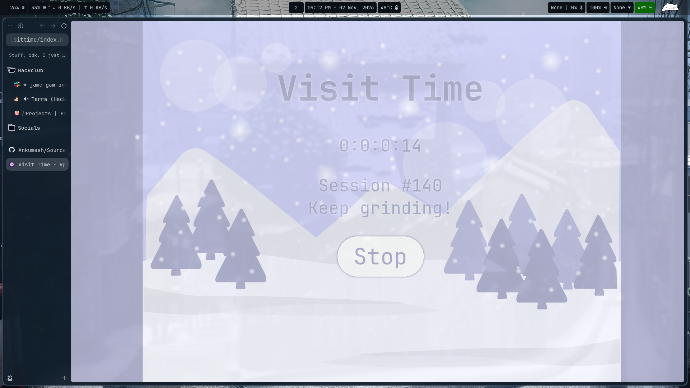

# Visit Time
A webpage that counts the amount of time you've spent staring at it

> [!NOTE]
> This repo is a fork of [kpoovakan/visittime](https://github.com/kpoovakan/visittime)

## Demo
Should be at [https://ankumeah.github.io/visittime](https://ankumeah.github.io/visittime)
but in case its not, I probably just got lazy ;]

## Features
- Seconds
- Minutes
- Hours
- Days
- Total sessions, stored locally

## Credits and Licensing
Orginal by [kpoovakan](https://kpoovakan.github.io). Licensed under the [Boost Software License](https://github.com/kpoovakan/visittime/blob/main/LICENSE). The winter wonderland background was drawn in [Turbowarp](https://turbowarp.org/editor).
(Seriously tho, amazing art)

Forked by [me](https://github.com/Ankumeah)!
